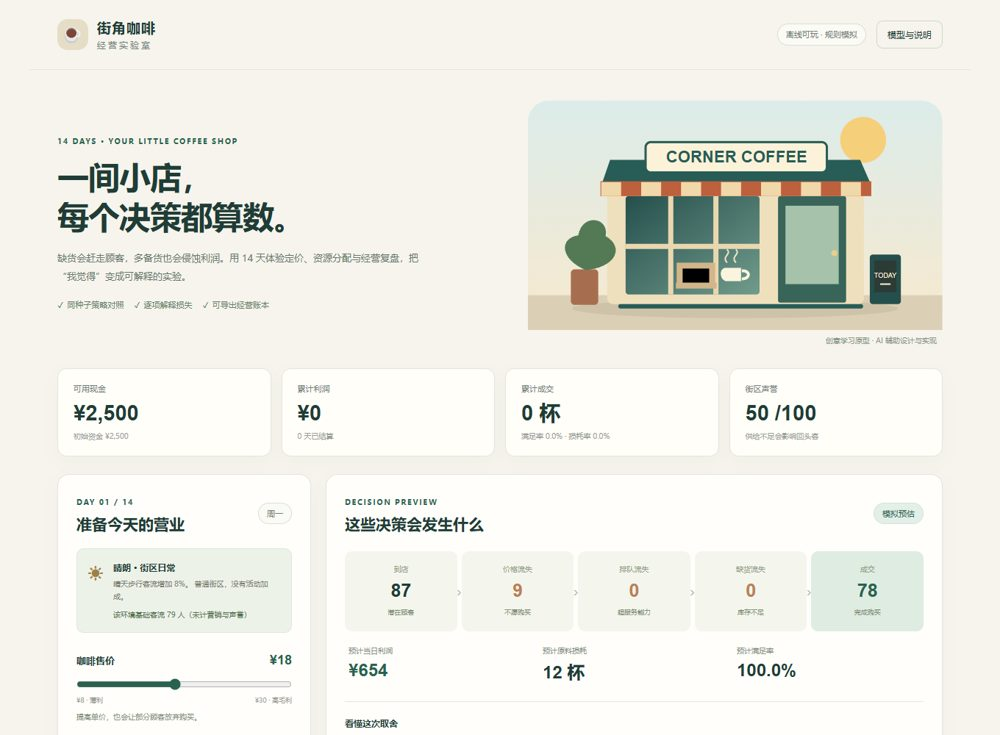

# 街角咖啡经营实验室

[在线试玩](https://frost-guard-d3gw4cry5916d32c4-1503361620.tcloudbaseapp.com/coffee-lab/) · [产品需求与规则](PRD.md) · [模型检查](TEST_REPORT.json) · [策略实验](EXPERIMENTS.json)

2026.10 新增 AI 辅助产品学习原型。腾讯云 CloudBase CLI 静态部署，公网首次访问可能需要点击“确定访问”。



## 发现的问题

经营玩法如果只给出利润，玩家很难判断是定价、排队、备货还是成本导致损失。设计假设是：明确展示损失来源，可以帮助玩家有依据地调整下一轮；目前尚未用真实玩家访谈验证这一假设。

## 产品交付

14 天经营；售价、备货、店员与营销四个决策；实时规则预估；互斥客流反馈与逐日账本；同种子重开对照；本机存档、JSON 回放、CSV 导出。预算不足与结束状态阻断无效结算。

## 运行与验证

下载仓库后，用 Chrome / Edge 打开 `index.html` 即可离线运行。Node.js 18+ 无需额外依赖：

```bash
node coffee-lab/tests.js
node coffee-lab/experiments.js
```

- 20 项模型检查，覆盖 600 个参数组合：守恒、费用、现金、预算、终止和回放。
- 3 种策略 × 10 个预先固定种子，30 轮规则模拟；完整种子与逐轮结果保留。
- [本地浏览器检查](BROWSER_REPORT.json)与[公网验证](PUBLIC_REPORT.json)分别记录交互和部署结果。

这组模拟中高备货卖得更多，但损耗使平均利润低于低价少备。需求匹配策略使用已知当日环境；种子仅固定外部事件，声誉随策略变化，后续到店量可能不同。

## 当前范围

客流、成本与收益是规则模拟，未调用大模型 API，不代表真实门店收益或真实用户 A/B。设计与编码由 AI 辅助完成。下一轮应观察真实玩家能否解释损失，再判断交互是否有效。
