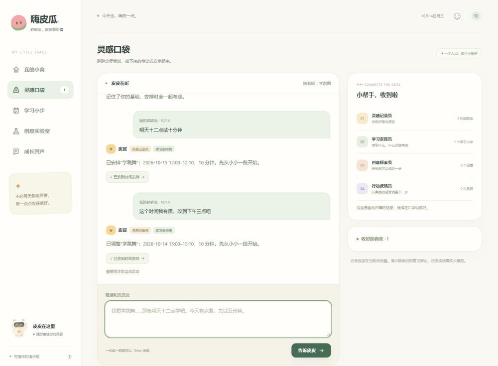

# 嗨皮瓜：任务日期继承诊断

[在线原型](https://frost-guard-d3gw4cry5916d32c4-1503361620.tcloudbaseapp.com/haipigua/) · [公网观察记录](browser-observation.txt) · [回归结果与 trace](date-regression.json)

嗨皮瓜以一个自然语言入口承接兴趣记录、学习安排、创意探索与行动反馈，当前为本地规则与浏览器存储。黑客松参与信息由作品提供者陈鹏旭提供。本目录是 2026.10.14 的诊断快照与本地修复提案，不是整个网站的部署包。



## 发现的问题

“明天十二点试十分钟”已生成 10/15 的任务。随后说“这个时间我有课，改到下午三点吧”，公网原型将任务变成 10/14 15:00。用户仅想修改时间，任务日期却丢失。

## 定位与方案

路由已找到待替换任务，但未明确新日期时仍使用“今天”的解析默认值。字段合法并不代表最终任务正确。

规则：修改未来任务且没有显式新日期时继承原日期；明确说今天/后天等时采用新日期；新建任务保持原处理。修改的只是 schedule 日期生成分支。

## 本地回归

5 个样例：无日期改时间、显式今天、显式后天、新增明天行动、另一时间修改。原逻辑 3/5 通过，本地提议修复 5/5 通过。**这份修复尚未部署到嗨皮瓜公网。**

```bash
node haipigua-diagnostics/diagnose-date.cjs
```

不需第三方依赖。程序对原始 ramble.js 与替换提案分别执行，保存完整结果。ramble-date-proposed.js 是修复提案。样本小，结果只验证这些日期规则，不代表完整对话能力。
