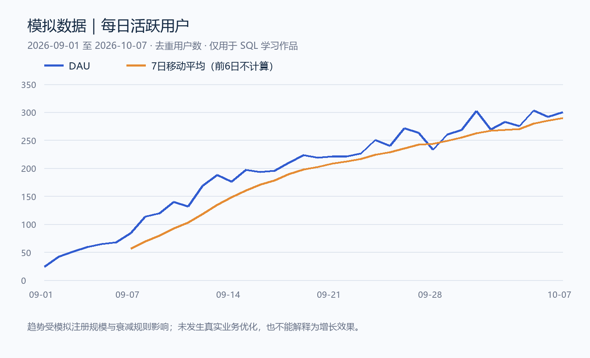
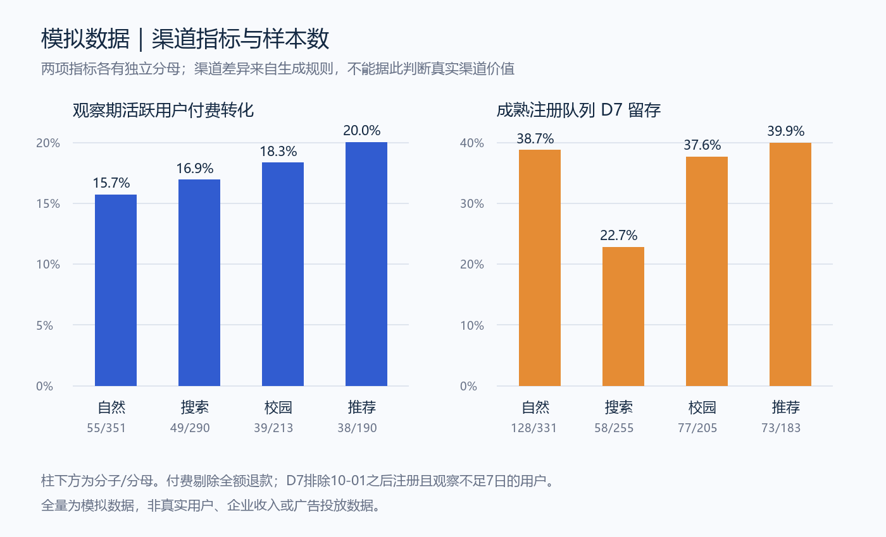

# AI工具产品用户行为分析：模拟数据 SQL 学习作品

**所有数据均由确定随机种子生成，没有真实企业、用户、收入或投放数据。作品由 AI 辅助创建于 2026-10-08，不是此前完成的实习或商业项目。分析结论没有商业验证。**

## 结果与口径

观察期为 **2026-09-01 至 2026-10-07（37日）**，时间统一按 Asia/Shanghai。截止快照为 2026-10-08 00:00:00，采用左闭右开时间区间。数据设定是一个虚构的 AI 工具产品，包含注册、启动、功能浏览、核心操作、付费墙浏览与订单快照。

| 指标 | SQL实际计算值 | 样本/定义 |
| --- | ---: | --- |
| 有效注册用户 | 1,176 人 | 原始1,200人剔除24名测试用户 |
| 观察期活跃用户 | 1,044 人 | 至少发生一次 launch，按 user_id 去重 |
| 清洗后事件 | 22,334 条 | 范围过滤、测试/不存在用户排除、event_uuid 去重 |
| 平均 DAU | 192.97 人/日 | 37个自然日全部纳入，每日不同活跃用户数之和/37 |
| 净付费用户 | 181 人 | 至少有一个已支付且扣退款后金额大于0的订单 |
| 已支付订单 | 220 笔 | 订单快照去重后状态paid，包含后续全额退款订单 |
| 正净额订单 | 205 笔 | 已支付且 amount_cents-refund_cents>0 |
| 注册用户付费转化 | 15.39% | 181/1176；观察期并不等长 |
| 活跃用户付费转化 | 17.34% | 181/1044 |
| 支付总额 | ¥15,108.00 | 去重后已支付订单 amount_cents之和/100 |
| 已退款金额 | ¥1,692.60 | 截止快照前已确认的refund_cents之和/100 |
| 净收入（练习口径） | ¥13,415.40 | 支付总额-已退款，不含失败/待支付；非会计收入 |
| 注册用户 ARPU | ¥11.41 | 净收入/1176名有效注册用户 |
| ARPPU | ¥74.12 | 净收入/181名净付费用户 |
| 注册队列 D7 留存 | 34.50% | 336/974名成熟注册用户，第7个自然日当天有launch |

## 数据质量处理

- 原始事件 **23,678条**，包含测试用户、越界时间、无对应用户与事件重传。有效范围事件记录为23,212条，删除重传 **878条**，得到22,334个业务事件。原始ID是导入行号，event_uuid才是业务事件键。
- 原始订单快照 **572条**，以order_id为业务键，用ROW_NUMBER保留截止日前最新快照。同金额/用户的不同order_id仍是不同订单，不能误删。
- 全额退款订单 **15笔**不计净付费用户和正净额订单；部分退款 **18笔**按剩余净额计入。仅有全额退款订单的用户不属于净付费用户。
- 10-01至10-07注册的 **202人**尚未获得完整D7观察窗，从留存分母中排除。未到观察窗不等于流失。
- 每日收入按订单创建日归属，并采用截止日退款快照回溯重算。它不是每日退款现金流，不适合替代财务核算。
- 事件和订单均先按用户聚合再关联渠道，避免“一人多事件 × 多订单”的JOIN造成收入重复。

## 可以解释的发现

1. 同一组净付费用户，以全体有效注册为分母时为 **15.39%**，以观察期活跃用户为分母时为 **17.34%**，相差 **1.95个百分点**。这展示口径差异，不是提升结果。报告应同时写分子、分母、窗口和退款规则。
2. 当前成熟注册队列D7留存为 **336/974=34.50%**。若误把202名未成熟用户当作未留存纳入分母，会变成 **28.57%**，导致低估。不能将两者混用。
3. 模拟渠道中活跃用户付费率最高的是模拟推荐渠道（**38/190=20.00%**），最低的是自然流量（**55/351=15.67%**）。生成器直接设定了渠道活跃差异，同时注册日期分布、抽样噪声和重复访问次数不同，因此不能得出真实渠道优劣或投放建议。

| 模拟渠道 | 注册 | 活跃 | 净付费 | 活跃付费率 | D7分子/分母 | D7留存 |
| --- | ---: | ---: | ---: | ---: | ---: | ---: |
| 自然流量 | 401 | 351 | 55 | 15.67% | 128/331 | 38.67% |
| 模拟付费搜索 | 319 | 290 | 49 | 16.90% | 58/255 | 22.75% |
| 模拟校园渠道 | 243 | 213 | 39 | 18.31% | 77/205 | 37.56% |
| 模拟推荐渠道 | 213 | 190 | 38 | 20.00% | 73/183 | 39.89% |

## 待验证问题与后续练习

- 如换成经授权的真实数据，需要先核验埋点完整性、业务事件ID稳定性、用户主键、支付和退款时间以及跨时区处理。
- 可新增同龄用户队列付费比较，控制注册时间与观察长度；目前转化是观察期覆盖率，不是每个用户注册后7天转化。
- 如设计实验，需定义主指标/护栏指标、随机分流、样本量和观察期，再分析置信区间。本作品没有开展A/B实验、没有效果提升结论。
- 行为覆盖查询统计“期间至少发生一次”各行为，未施加时序约束，不能称严格顺序漏斗。可另写带事件时间约束的漏斗作为练习。

## 复现与验证

随机种子：**20261008**。SQLite查询实际执行，生成8份结果CSV。Python从原始字典独立计算事件去重、活跃、付费、金额与D7分子分母，并与SQL对照；另验证渠道/日度金额和总额对账、滚动平均边界。共 **16项**全部通过，见`validation.json`。不将校验通过等同于商业结论成立。

此作品可以用于学习和展示SQL实践。本人完成理解、修改及独立复现之前，不宜写成“独立完成”或已掌握所有涉及的技能。
